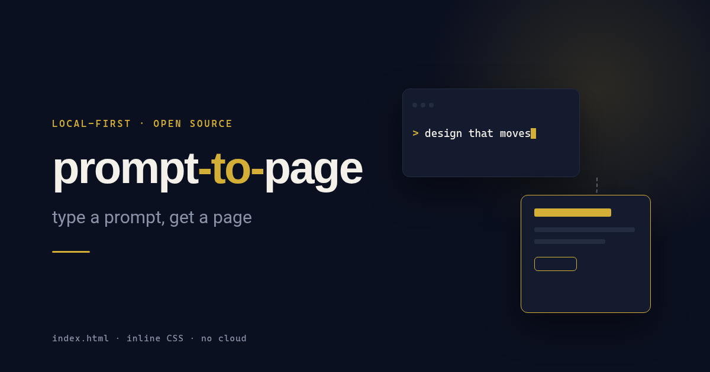

<div align="center">



# prompt-to-page

[](LICENSE)
[](#philosophy)
[](#philosophy)
[](https://github.com/brianconlan2023/prompt-to-page/stargazers)

A small, local-first alternative to heavyweight design tools. Type a prompt and get one HTML page. No cloud, no accounts.

[Website](https://github.com/brianconlan2023/prompt-to-page) · [Docs](#quick-start) · [Download](https://github.com/brianconlan2023/prompt-to-page/releases) · API (coming soon) · [Changelog](https://github.com/brianconlan2023/prompt-to-page/commits/main)

</div>

---

prompt-to-page turns a text prompt into a single `index.html` with inline CSS, which you open straight in your browser. It runs on [OpenDesign](https://github.com/nexu-io/open-design) and uses Xiaomi MiMo (`mimo-v2.6-pro`) or free local models through [OpenCode](https://opencode.ai). Everything stays on your machine except the calls to the model you choose. A bundled design system keeps pages on-brand, and a [HyperFrames](https://github.com/heygen-com/hyperframes) handoff skill lets you render a page's motion to MP4 locally, with no GPU needed.

## Quick start

Requirements: Node.js 24, and either a MiMo Token Plan key or OpenCode installed.

```bash
git clone https://github.com/nexu-io/open-design.git
cd open-design
npm install -g pnpm@10
pnpm install
pnpm tools-dev run web
```

Then copy this repo's `skills/hyperframes-handoff` and `design-systems/manifest-motion` folders into OpenDesign's `skills/` and `design-systems/` folders.

**MiMo:** add it as a custom OpenAI-compatible provider in OpenDesign Settings. Don't use the built-in MiMo preset, because it points to the China endpoint.

```text
Base URL: https://token-plan-sgp.xiaomimimo.com/v1
Model:    mimo-v2.6-pro
API key:  your tp- Token Plan key (never commit it)
```

**OpenCode:** pick OpenCode as the agent and choose a model. Small free models may not write files reliably.

Try the prompt in [`example-prompt.txt`](example-prompt.txt).

## Features

| Feature | Status |
| --- | --- |
| Prompt to a single `index.html` with inline CSS | Works today, through OpenDesign |
| Manifest Motion design system (tokens, type, motion presets) | Works today |
| HyperFrames motion export to MP4, rendered locally | Works today, through the handoff skill |
| URL to design-token extraction | Planned standalone module |
| Automatic model failover | Planned |

## Philosophy

- **One prompt, one file.** You get output you can read, open and host anywhere.
- **Local first.** No cloud backend, no accounts and no telemetry from this project.
- **Strict prompts.** Tell the model exactly which file to write and nothing else.
- **Do less, but finish it.**

## Contributing

Small, focused pull requests are welcome. See [CONTRIBUTING.md](CONTRIBUTING.md), and report security issues as described in [SECURITY.md](SECURITY.md).

---

<div align="center">

MIT © Manifestation16 · Built on OpenDesign (Apache-2.0)

</div>
